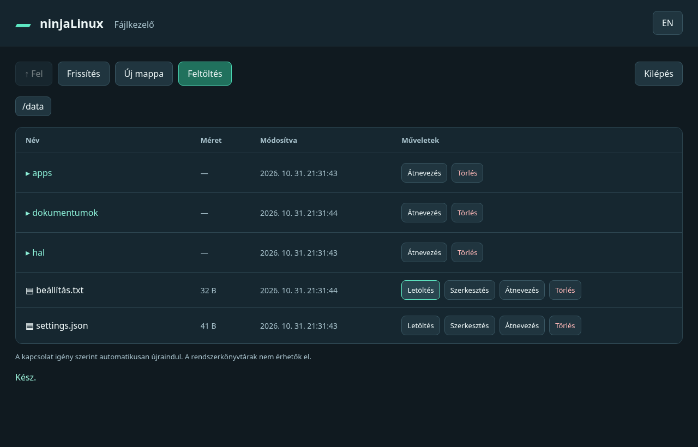

# Böngészős fájlkezelő, igény szerinti indítással

**[English](file-explorer.md)**

A ninjaLinux `/data` könyvtárának helyi hálózati fájlkezelője, asztali és
mobil böngészőhöz. A PC-re/telefonra nem kell alkalmazást telepíteni, SSH-kulcs
sem kell: saját, készülékenként beállított belépési kódot használ.



## Fordítás és bekapcsolás

```sh
NINJALINUX_FILE_EXPLORER=1 ./scripts/build.sh rt
# A többi addon is kombinálható:
NINJALINUX_FILE_EXPLORER=1 NINJALINUX_USB_AUTOSTART=1 \
NINJALINUX_BOOT_LOGO="$PWD/examples/boot-logo/ninjalinux.png" ./scripts/build.sh rt
```

Az addon külön buildkönyvtárat és image-nevet használ, `-explorer`
végződéssel. Például `/tmp/fastlinux-build-explorer` és
`artifacts/fastlinux-rt-explorer.img.gz`; minden fenti addon együtt
`-usb-logo-explorer`. Működik a `rt-wifi` és `rt-wifi-ap` profilokkal is.
Váltáskor külön `FASTLINUX_OUT` kell. A korábbi kiadott image-ek ettől nem
frissülnek automatikusan; addonként fordított image szükséges.

A [mintakonfigurációban](../examples/file-explorer/file-explorer.json)
töltsd ki a `token` mezőt **saját, véletlenszerű belépési kóddal**. A minta
üres kóddal szándékosan nem indul. Nincs közös/gyári belépési kód.

```json
{
  "enabled": true,
  "port": 8080,
  "idle_timeout": 30,
  "token": ""
}
```

A `token` mezőt töltsd ki; 24–128 nyomtatható ASCII-karakter kell,
szóköz nélkül. Linuxon például:

```sh
python3 -c 'import secrets; print(secrets.token_urlsafe(24))'
```

Windows PowerShellben:

```powershell
$bytes = New-Object byte[] 32
[Security.Cryptography.RandomNumberGenerator]::Create().GetBytes($bytes)
[Convert]::ToBase64String($bytes)
```

A fájl UTF-8 kódolású legyen, BOM nélkül. Két beállítási út van:

- Kikapcsolt készülék SD-kártyájának FAT bootpartíciójára másold
  `file-explorer.json` néven. A rendszer az első érvényes konfigurációt
  átveszi a `/data/file-explorer.json` helyre. Ehhez nem kell SSH.
- Működő SSH-elérésnél közvetlenül a `/data/file-explorer.json` fájlt is
  létrehozhatod; jogosultsága `600` legyen.

A meglévő `/data/file-explorer.json` elsőbbséget élvez, a bootfájl nem írja
felül. Hibás/letiltott/hiányzó konfigurációnál a webes szolgáltatás nem indul,
**a készülék és a grafikus alkalmazás ettől továbbindul**.
A szolgáltatás a konfiguráció módosítását újraindításkor veszi biztosan át:
`/etc/init.d/S38file-explorer restart`, vagy a készülék következő indulása.
A bootpartíción maradt belépési kódot a beállítás után eltávolíthatod.

## Használat

Böngészőben: **`http://192.168.0.234:8080`**. A Pi tényleges címét és a
beállított portot használd; helyi Wi-Fi AP-n a Pi AP-címe is használható.
Írd be a belépési kódot. A felület magyar/angol, az `EN`/`HU` gomb váltja.

- Mappanyitás, feljebb lépés és morzsamenü a `/data` gyökérig.
- Feltöltés, több fájl is; legfeljebb 64 MiB fájlonként. A felülírásra
  külön rákérdez. A feltöltés ideiglenes fájlból, atomi cserével kerül a helyére;
  megszakításkor a korábbi fájl megmarad. Meglévő fájl tulajdonosa/jogai megmaradnak.
- Letöltés a PC-re/telefonra.
- Új mappa és átnevezés. Az átnevezés nem ír felül másik fájlt/mappát.
- Megerősítéses törlés. Mappából csak üres törölhető, nincs rekurzív törlés.
- Legfeljebb 1 MiB méretű UTF-8 szövegek szerkesztése; mentéskor külön
  felülírási megerősítés. JSON, HAL és szöveges beállítások így kezelhetők.

Fájlmódosítás nem indítja újra automatikusan a HAL-t vagy a grafikus appot.
A készülék belső gyökérpartícióját nem teszi írhatóvá. Symlinkeket és
speciális fájlokat nem követ és nem módosít; egy mappanézet maximum 5000
bejegyzést kezel. A `/data/cartridges` alá csatolt USB-cartridge-ok is böngészhetők;
írni csak a cartridge által engedélyezett `writable: true` módban lehet.

A kód csak az adott böngészőlap memóriájában marad: frissítés vagy kilépés
után újra be kell írni. Fájlnevek és tartalmak nem kerülnek HTML-ként
futtatásra. A protokoll helyi **HTTP, TLS nélkül**; megbízható gépi/helyi
hálózatra készült, internetre ne tedd ki.

## Igény szerinti működés

A BusyBox `inetd` kis kapcsolatfogadója állandóan figyel a beállított porton.
A Python-folyamat **csak bejövő TCP-kapcsolatkor** indul el, még a HTTP-kérés
feldolgozása előtt. Böngészővel nem lehet teljesen nulla kapcsolatfogadó
folyamat mellett bejövő HTTP-kérést érzékelni.

Az `inetd` `wait` módjában a Python a figyelő socketet kapja meg. Egy kezelő
fut egyszerre, a kéréseket sorban szolgálja ki; nincs háttérbeli folyamatos
lekérdezés vagy böngészős keepalive. Az utolsó kapcsolat után `idle_timeout`
(default 30, állítható 5–300 másodperc) tétlenségkor kilép. A következő
műveletre automatikusan újraindul, az oldalt nem kell újratölteni.
A lassú/üres kapcsolat olvasási timeoutja 15 másodperc, egy kérés teljes
időkorlátja 60 másodperc. Hosszú átvitel idején más művelet várakozhat.
A listener és a kezelő a 0–1 housekeeping magokon fut; nem kapja meg a HAL
izolált magját.

## Diagnosztika és ellenőrzés

```sh
cat /tmp/file-explorer.log
cat /run/ninjalinux-file-explorer/inetd.pid
cat /run/ninjalinux-file-explorer/worker.pid
```

Az utolsó csak aktív Python-kezelőnél létezik. A listener leállítható:
`/etc/init.d/S38file-explorer stop`. A `/data/file-explorer.json` fájlban
`enabled: false`, majd szolgáltatás-/rendszer-újraindítás tartósan kikapcsolja.

PC-s ellenőrzés: `python3 -m unittest discover -s tests` helyi loopback
socketek engedélyezésével és Pillow-val. Valódi HTTP-tesztek ideiglenes
adatkönyvtáron, tokenellenőrzés, útvonal-/symlink-korlátok, megszakított
feltöltés, atomi átnevezés, tétlen kilépés/újraaktiválás. Chromiumban asztali
és mobilnézet, UTF-8 feltöltés/szerkesztés, mappakezelés, letöltés, törlés,
nyelvváltás és kilépés is ellenőrizve. Buildroot Kconfig-feloldás ellenőrizve.
A Pi-n történő telepítés, az image teljes fordítása és RT-terhelésmérés
még hátravan; a futó eszközön nincs változtatás.
