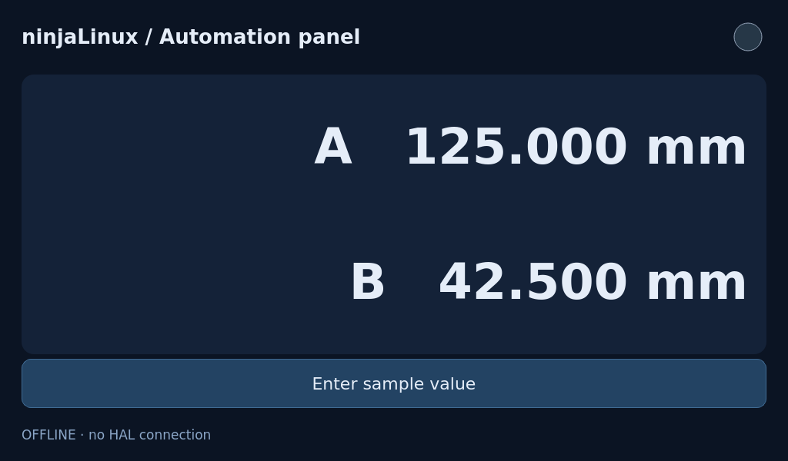

# ninjaLinux UI-eszközök

Magyar · **[English](README.md)**

1024×600-as érintőfelületek tervezése PC-n, majd exportálás Python/PySide6
alkalmazásként ninjaLinuxra. A csomag a **Qt Widgets Designerhez** készült.
Az EsztergaDRO-tól független, gépspecifikus vezérlést nem tartalmaz.



A kép PC-n renderelt offline minta, nem a Pi-ről készült fénykép.

## Szerkesztő és PC-s telepítés

A használható szerkesztő a **[PySide6-hoz tartozó Qt Widgets Designer](https://doc.qt.io/qtforpython-6/tools/pyside-designer.html)**.
A [hivatalos Qt for Python telepítési leírás](https://doc.qt.io/qtforpython-6/gettingstarted.html)
ismerteti a Python-csomagokat. A teljes PySide6 tartalmazza a Designert.
Qt Creator is szerkeszt `.ui` fájlokat, de az itteni indító a
`pyside6-designer` eszközzel tölti be a saját Python-widgeteket.
A Qt Design Studio/QML más munkamenet.

PySide6 által támogatott Python 3.11 vagy újabb kell. A repó gyökeréből:

Linux:

```sh
cd ui-tools
python3 -m venv .venv
. .venv/bin/activate
python -m pip install "PySide6==6.11.2"
```

Windows PowerShell:

```powershell
cd ui-tools
py -m venv .venv
.\.venv\Scripts\python.exe -m pip install "PySide6==6.11.2"
# Aktiválás nélkül is használható ezzel az értelmezővel:
.\.venv\Scripts\python.exe ninjaui_tools.py new work/panel.ui
.\.venv\Scripts\python.exe ninjaui_tools.py designer work/panel.ui
```

Egy részleges disztribúciós PySide6-csomagból hiányozhat a QtDesigner,
QtUiTools vagy QtTest. A teljes PC-s csomag ezt elkerüli; a Pi-re nem kerülnek
be ezek a fejlesztői modulok.

## Létrehozás, szerkesztés, előnézet

Aktív virtuális környezettel, a `ui-tools/` könyvtárból:

```sh
python ninjaui_tools.py new work/panel.ui
python ninjaui_tools.py designer work/panel.ui
python ninjaui_tools.py check work/panel.ui
python ninjaui_tools.py preview work/panel.ui
```

Üres képernyő: `python ninjaui_tools.py new --blank work/empty.ui`.
A `new` meglévő fájlt nem ír felül. A Designer **Widget Box** paneljén keresd
a **ninjaLinux** csoportot. A tulajdonságok a Property Editorban állíthatók;
használj layouteket, majd mentsd a `.ui` fájlt. A **Save Form As Template**
menüponttal a saját terv is menthető Designer-sablonként. Az alapsablon
1024×600-as; a csomag nem külön Designer-alkalmazás.

Az előnézet 1024×600-as PC-s ablak. A minta **Enter sample value** gombja
megnyitja a beépített számbillentyűzetet. Az OK csak az offline A-kijelzés
értékét módosítja; a Cancel visszalép. A `--demo` szintetikus számokkal és
LED-del animál, HAL nélkül. Kézi értékbeíráshoz a sima előnézetet használd,
mert a demóanimáció felülírja az értékeket. A stíluslap Designerben
szerkeszthető; a célrendszer DejaVu Sans betűkészletét használja.

```sh
python ninjaui_tools.py preview work/panel.ui --demo
python ninjaui_tools.py preview work/panel.ui --offscreen --screenshot work/panel.png --quit-after 400
```

## Használható saját elemek

| Elem | Szerkeszthető tulajdonságok | Jelzések, viselkedés |
|---|---|---|
| `StatusLed` | `active`, `connected`, `halPin` | Aktívan zöld; kapcsolat nélkül szürke `?`; kimenetet nem ír |
| `AxisDisplay` | `value`, `decimals` (0–6), `axisLabel`, `suffix`, `connected`, `halPin` | Általános számkijelzés; kapcsolat nélkül `—`; nincs koordináta-/szerszámlogika |
| `TouchButton` | Szokásos QPushButton-tulajdonságok | Egy másodperces tartásra `longPressed()`; felengedéskor a szokásos `clicked()` is megmarad |
| `NumericPad` | `value` | `accepted(float)`, `cancelled()`; tizedespont, előjel, törlés; beágyazott QWidget |

Csak hosszú nyomásra működő művelethez a `longPressed` jelet kösd be; ne kapjon
vele ütköző rövid műveletet a `clicked`. A számbillentyűzet értéket jelez,
HAL-t nem ír. A mintaindító csak a minta nevesített kezelőit köti össze:
`pages`, `keypad`, `editButton`, `statusLabel`. A saját alkalmazásműködést
külön Python-kódban kell megírni.

A [profil](profile.json) felsorolja a támogatott alapwidgeteket, layouteket és
saját osztályokat. A jelenlegi kép Core/Gui/Widgets/Network/OpenGL/
OpenGLWidgets moduljaihoz igazodik. WebEngine, QML/Quick, SVG, SQL és
multimédiás elemek nem részei ennek a profilnak. A szabványos dátum-, lista-
és táblázatvezérlőkhöz továbbra is kell alkalmazáslogika; automatikus érintős
beviteli módot nem kapnak.

A Designer szokásos palettáján más elemek is megjelenhetnek. A `check` elutasítja
a nem támogatott osztályokat, hibás képernyőméretet, ellentmondó méretkorlátokat,
dupla objektumneveket, ismeretlen saját deklarációkat és nem támogatott
képhivatkozásokat. Ez előzetes ellenőrzés: nem bizonyítja minden Qt-tulajdonság,
elrendezés és grafikus működés hardveres helyességét. A `.ui` és a plugin
megbízható alkalmazásforrásnak tekintendő, nem elkülönítetten futtatott bemenet.
A tényleges célgépen is ellenőrizni kell a kész alkalmazást.

## Export és kézi Pi-próba

```sh
python ninjaui_tools.py build work/panel.ui --output build/panel
```

A PC hivatalos `pyside6-uic`, illetve szükség esetén `pyside6-rcc` eszköze fut.
A csomag tartalma: `app.py`, generált felület/erőforrások, widgetek és futtató,
`manifest.json`, tájékoztatásként `source.ui`, valamint `run-pi.sh`.
Nem tartalmaz fordítót, Designert, QtUiTools-t, HAL-runtime-ot vagy gépkonfigurációt.
Újraszerkesztéshez őrizd meg az eredeti projektet és képeket. Meglévő célkönyvtárat
nem ír felül: új exporthoz válassz másik könyvtárat.

A PNG-ikonokat Designer `.qrc` fájllal, a form könyvtárán belül kezeld,
`:/...` hivatkozással. Python-erőforrássá fordulnak; abszolút útvonal, projekten
kívüli fájl és nem PNG-kép nem támogatott. A PC-s PySide6 legfeljebb 6.11.2 lehet;
az egyező 6.11.2 ajánlott. Arm64 binárist nem kell fordítani a Python-felülethez.

A `build/panel/` könyvtárat másold például a Pi `/data/ui-panel/` könyvtárába
[SSHFS-sel](../docs/sshfs.hu.md) vagy
[Windowsról/WinSCP-vel](../docs/windows-remote.hu.md).
Karbantartási munkamenetben, a jelenlegi grafikus felület szokásos módon
elvégzett leállítása után:

```sh
cd /data/ui-panel
sh run-pi.sh
```

Az EGLFS/KMS kijelzőt egyszerre egy felület használja. Az indító felismeri a
DRM-kártyát; aktív `2-3` izolációs profilnál CPU2-n indít. Nem állítja le a
jelenlegi felületet, nem választ bootalkalmazást, nem módosít szolgáltatást,
és nem indítja újra a gépet. Az automatikus bootba építés külön feladat.

## Választható, csak olvasó HAL-kapcsolat

A PC-s előnézet nem kapcsolódik HAL-hoz. Már futó privát HAL Pi-n történő
figyeléséhez állítsd be a LED/számkijelző `halPin` tulajdonságát, exportálj
újra, majd a **futó HAL tulajdonosának felhasználójával** indíts:

```sh
sh run-pi.sh --hal-read
```

Az indító az `/opt/automation-hal/bin/ahal python` környezetét használja.
Az adapter a saját felhasználó privát vezérlősocketét és Python-kötését igényli;
HAL-t és komponenst nem indít. 100 ms-onként olvassa a megadott értékeket.
Hibás/hiányzó adatnál kapcsolat nélküli jelzés látszik; a be nem kötött elemek
is elérhetetlen állapotot mutatnak ebben a módban. A minta kézi értékbeírása
ilyenkor tiltott. A `--hal-read` és a `--demo` egyszerre nem választható.
Kimenetvezérlés nincs; a GUI-lekérdezés nem realtime vezérlés és nem alkalmas
rövid impulzusok megbízható rögzítésére.

Távoli PC-s diagnosztikához a külön [HALShow-útmutató](../docs/halshow.hu.md)
használható. Az itteni adapter a célgépen helyi kapcsolatot használ.

## Saját elemek és ellenőrzés

Az [AGENTS.md](AGENTS.md) leírja a widgetkészítést, tulajdonságokat,
Designer-regisztrációt, profilbővítést, a HAL határát és az ellenőrzési lépéseket.
Az eredeti eszközkód a repó [MIT licence](../LICENSE) alatt áll;
a Qt/PySide és a felhasznált külső képek megtartják saját feltételeiket.

```sh
python tests/test_tools.py
```

Ellenőrzés 2026-10-31-én, Linux/amd64, Python 3.13, PC-s PySide6 6.11.2:
11 sikeres teszt, tényleges generált UI-/erőforrás-futtatással,
Designer-regisztrációval és formbetöltéssel, beviteli/tartási próbával és
ál-HAL-adatok hibakezelésével. A Designer offscreen módban megnyitotta a formot.
A panel a gép PySide6 6.8.2.1 környezetével is exportálható és futott.
Mindkét lap 1024×600-as képét szemrevételezéssel ellenőriztük.
Windows-, fizikai érintési, EGLFS/OpenGL- és élő Pi-HAL-próba ebben a körben
nem történt.
