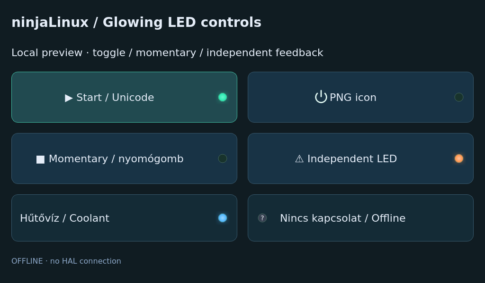
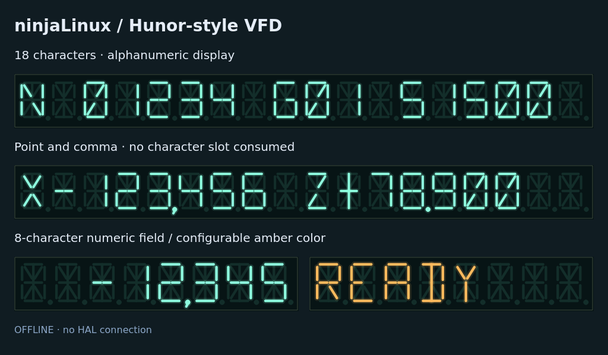

# ninjaLinux UI tools

English · **[Magyar](README.hu.md)**

Design 1024×600 touch interfaces on your PC and export a Python/PySide6 app
for ninjaLinux. This is a development kit for **Qt Widgets Designer**.
It is independent of EsztergaDRO and contains no machine-specific control logic.


The image is a PC-rendered offline example, not a photograph of the Pi.

## Editor and PC installation

Use **[Qt Widgets Designer through PySide6](https://doc.qt.io/qtforpython-6/tools/pyside-designer.html)**.
The official [Qt for Python installation guide](https://doc.qt.io/qtforpython-6/gettingstarted.html)
explains the Python packages. Designer is included with a full PySide6 installation;
Qt Creator can also edit `.ui` files, but this kit's launcher uses `pyside6-designer`
to load the Python custom widgets. Qt Design Studio/QML is a different workflow.

Use Python 3.11 or newer supported by PySide6. From the repository root:

Linux:

```sh
cd ui-tools
python3 -m venv .venv
. .venv/bin/activate
python -m pip install "PySide6==6.11.2"
```

Windows PowerShell:

```powershell
cd ui-tools
py -m venv .venv
.\.venv\Scripts\python.exe -m pip install "PySide6==6.11.2"
# Use this interpreter for the commands below; activation is optional:
.\.venv\Scripts\python.exe ninjaui_tools.py new work/panel.ui
.\.venv\Scripts\python.exe ninjaui_tools.py designer work/panel.ui
```

A partial distribution package may omit QtDesigner/QtUiTools/QtTest.
The complete PC package avoids this. Those modules are not added to the Pi.

## Create, edit and preview

With the virtual environment active, from `ui-tools/`:

```sh
python ninjaui_tools.py new work/panel.ui
python ninjaui_tools.py designer work/panel.ui
python ninjaui_tools.py check work/panel.ui
python ninjaui_tools.py preview work/panel.ui
```

`new --blank work/empty.ui` creates the empty screen instead. `new` never
overwrites an existing form. In Designer, look for the **ninjaLinux** group
in the Widget Box. Edit properties in the Property Editor, use layouts and
save the `.ui`. You can save a form as a Designer template using its normal
**Save Form As Template** action. The supplied forms open at 1024×600;
this is a form template/profile, not a replacement Designer application.

`preview` opens a 1024×600 desktop window. The sample's **Enter sample value**
button opens its embedded keypad; OK changes only the offline A display and
Cancel returns. `--demo` animates synthetic values and the LED, without HAL.
Use ordinary preview for editing a sample value; demo animation replaces values.
The root stylesheet is editable in Designer and uses the target's DejaVu Sans.

```sh
python ninjaui_tools.py preview work/panel.ui --demo
python ninjaui_tools.py preview work/panel.ui --offscreen --screenshot work/panel.png --quit-after 400
```

## Available elements

| Element | Editable properties | Signals / behavior |
|---|---|---|
| `LedButton` | `text`, `icon`, `iconSize`, `checkable`, `followButton`, LED properties | Touch button with local toggle/momentary LED or independent feedback; inherited one-second hold |
| `LedLabel` | Standard QLabel properties and LED properties | Unicode-capable status label; no click/output action |
| `StatusLed` | `active`, `connected`, `halPin` | Green when active; grey `?` when disconnected; no output writes |
| `AxisDisplay` | `value`, `decimals` (0–6), `axisLabel`, `suffix`, `connected`, `halPin` | Generic numeric label; disconnected data displays `—`; no coordinate/tool logic |
| `TouchButton` | Standard QPushButton properties | `longPressed()` after a one-second hold; standard `clicked()` still fires on release |
| `NumericPad` | `value` | `accepted(float)`, `cancelled()`; decimal/sign/backspace/clear; embedded QWidget |
| `VfdDisplay` | `text`, `value`, `decimals`, `decimalSeparator`, `characterCount`, colors, brightness, `halPin` | Hunor-style 14-segment readout; independent point/comma; optional read-only HAL values |

For hold-only actions connect `longPressed`; do not also bind a conflicting
`clicked` action. The numeric input emits a value and does not write HAL.
The sample runner wires only the sample's named controls (`pages`, `keypad`,
`editButton`, `statusLabel`); add your application behavior in Python separately.

The [profile](profile.json) lists supported standard widgets, layouts and
custom classes. It follows the current image's Core/Gui/Widgets/Network/
OpenGL/OpenGLWidgets modules. WebEngine, QML/Quick, SVG, SQL and multimedia
widgets are outside this profile. Standard date/list/table controls still
need application data/behavior; touch input methods are not automatic.

The ordinary Designer palette may show other widgets. `check` rejects unsupported
classes, wrong screen geometry, conflicting sizes, duplicate object names,
unrecognized custom declarations and unsupported resource paths. It is a
conservative preflight, not proof that every Qt property, layout or graphics
path will work on hardware. UI files and plugins are trusted application source,
not sandboxed input. Check the generated app on the actual target before use.

## LED buttons, labels and icons



```sh
python ninjaui_tools.py new --led work/led/panel.ui
python ninjaui_tools.py designer work/led/panel.ui
python ninjaui_tools.py preview work/led/panel.ui
```

The new **LedButton** and **LedLabel** elements are in Designer's **ninjaLinux**
group. `new --led` copies the form, its `.qrc` and original MIT power-icon PNG
into a separate editable project. It refuses to overwrite existing assets.
Export them with the normal `build` command; the compiled icon travels with
its bundle and needs no desktop icon theme or SVG module.

Both widgets expose these editable properties and matching setters:

| Property | Meaning |
|---|---|
| `active`, `connected` | LED state and valid-data flag; disconnected shows a grey `?` |
| `ledColor`, `offColor` | Active and unlit lens colors |
| `ledDiameter`, `ledOnRight` | Lens diameter (6–48 logical px) and right/left position |
| `glow`, `glowRadius`, `glowStrength` | Cached VFD-style bloom, 0–24 px radius and 0–100 strength |
| `brightness` | Emitted-light intensity, 0–100 |
| `halPin` | Optional read-only bit/integer feedback pin |

`LedButton` inherits the normal QPushButton `icon`, `iconSize`, `text`, `font`,
`clicked`, `pressed`, `released`, `toggled` and checkable behavior, plus
TouchButton's one-second `longPressed`. Its LED never intercepts touches.
With `followButton=True` (default), a checkable button follows `checked`; a
non-checkable one lights while pressed. Set `followButton=False` for independent
feedback through `setActive(bool)`. `LedLabel` retains QLabel text/font/alignment
behavior and has no action. Changing these widgets alone never writes hardware.

With `--hal-read`, the reader disables `followButton` and updates only the LED
from the named existing pin. A button's checked/clicked state is still local UI
state; it is not a hardware command or proof of an output state. Missing pin
data shows disconnected, not a false OFF indication.

### Unicode symbols and font coverage

Qt text accepts Unicode; **UTF-8 is an encoding, not a guarantee that every
symbol has a glyph**. The target image includes DejaVu Sans. In the tested
DejaVu Sans file, `▶` (U+25B6), `■` (U+25A0) and `⚠` (U+26A0) are available;
`⏻` (U+23FB) and `💧` (U+1F4A7) are missing. The example therefore uses a PNG
power icon. Put a supported symbol directly into the button's `text` property,
or select a resource PNG through Designer's standard `icon` property.
[Qt font fallback documentation](https://doc.qt.io/qt-6/qfont.html).

Check an explicit font file before relying on a symbol:

```sh
python ninjaui_tools.py font-check "▶■⚠" --font-file /usr/share/fonts/truetype/dejavu/DejaVuSans.ttf
```

For a target-specific check, use a copy of the Pi's actual `.ttf` file on the PC;
a richer PC font collection can otherwise hide a missing target glyph. The
command reports `OK`/`MISSING` per Unicode code point and returns 1 for missing
characters. It runs without a visible window and does not install fonts.
This checks individual glyph coverage, not emoji colors, multi-character
sequences or full-script shaping. For reliable appearance across installations,
use a PNG resource; additional fonts require explicit application/image work.

## Hunor-style VFD display



Create its 1024×600 example and open it in the same Designer:

```sh
python ninjaui_tools.py new --vfd work/vfd.ui
python ninjaui_tools.py designer work/vfd.ui
python ninjaui_tools.py preview work/vfd.ui
```

Drag **VfdDisplay** from the **ninjaLinux** widget group onto any form.
Its turquoise 14-segment appearance follows the existing Hunor web simulator.
It is drawn with QPainter and cached between changes; it needs neither SVG nor
OpenGL, a font asset, the simulator or controller hardware. [Origin notes](VFD-ORIGIN.md).

| Property | Meaning |
|---|---|
| `text` | Alphanumeric text, rendered uppercase; unsupported characters become `?` |
| `characterCount` | 1–64 cells; default 18, matching the simulator's display bank |
| `value`, `decimals` | Numeric input via `setValue(float)`; 0–6 decimal places |
| `decimalSeparator` | `.` or `,` for numeric formatting; default `.` |
| `rightAligned` | Align the content to the right of the fixed-width bank |
| `foregroundColor`, `backgroundColor`, `offColor` | Active strokes, glass and inactive strokes |
| `brightness`, `glow` | 0–100 emission intensity and bloom on/off |
| `glowRadius`, `glowStrength` | Halo extent in logical pixels (0–24, default 6) and strength (0–100, default 70) |
| `connected`, `halPin` | Missing-data indication and optional existing-runtime numeric pin |
| `overflow` | Read-only: content exceeds the available cells |

Both `.` and `,` attach to the preceding character without consuming another
cell. The comma has a visible tail; an initial separator occupies a blank cell.
Text and numeric mode share the screen: the last `setText`/`setValue` wins.
Changing `decimalSeparator` reformats numeric mode; literal `text` stays as entered.
For overlong numeric values all cells light as `#` instead of showing a truncated
number. Overlong literal text is clipped, with `overflow=True`. Disconnection shows
`NO DATA` (dashes on banks shorter than seven cells). The reference's `:` glyph
is an hourglass, not a conventional colon; this is not an original Hunor PROM dump.
The class exposes `setText(str)` and `setValue(float)` as Qt slots.

The glow combines a broad colored bloom, a tighter halo and a paler segment
core. Qt smooth image resampling softens only the active strokes, including
points and commas. This is cached with the final image and recalculated only
when the content, appearance, size or display scale changes; no animation timer
or continuously running blur effect is added. `brightness=0` extinguishes the
emitted light. `glow=False`, zero radius or zero strength gives the flat style.
Start with radius 6 and strength 70; increase gently for a softer appearance.
PC rendering was checked, including high-DPI output; Pi rendering cost has not
been measured.

Export and Pi launch use the same commands as the other forms. The optional
HAL reader treats it as a numeric readout. No output control is added.

## Build and manual Pi trial

```sh
python ninjaui_tools.py build work/panel.ui --output build/panel
```

This runs the PC's official `pyside6-uic` and, if needed, `pyside6-rcc`. The
bundle contains `app.py`, generated form/resources, reusable runtime/widgets,
`manifest.json`, `source.ui` for reference and `run-pi.sh`. It contains no
compiler, Designer, QtUiTools, HAL runtime or machine configuration. Keep the
original project and assets for future editing/rebuilding. Existing output
directories are refused; choose a new one when rebuilding.

PNG icons should be included through a Designer `.qrc` resource file under
the form's directory, referenced as `:/...`. Resources are compiled into Python;
absolute paths, files outside the project and non-PNG assets are rejected.
The tool accepts PC PySide6 versions up to 6.11.2; matching 6.11.2 is recommended.
The screen's pixel layout does not require compiling an arm64 executable.

Copy `build/panel/` to a writable directory on the Pi, for example
`/data/ui-panel/`, using [SSHFS](../docs/sshfs.md) or
[Windows/WinSCP](../docs/windows-remote.md). During a maintenance session,
with the current GUI already stopped through your existing maintenance process:

```sh
cd /data/ui-panel
sh run-pi.sh
```

Only one GUI should own the EGLFS/KMS display. The script manually launches the
bundle, detects its DRM card, and uses CPU2 when the existing `2-3` isolation
profile is active. It does not stop the installed GUI, select a boot application,
change services or reboot. Automatic boot integration is separate from this kit.

## Optional read-only HAL

Preview never connects to HAL. To monitor an existing private HAL on the Pi,
set `halPin` on a LED/readout in Designer, build again, and run as the **same
account that owns the existing HAL**:

```sh
sh run-pi.sh --hal-read
```

The launcher uses `/opt/automation-hal/bin/ahal python`. The adapter requires
the current user's private control socket and private Python binding; it does
not start HAL or create a component. Every 100 ms it reads the named values.
Missing or invalid readings become disconnected, and unbound readouts are marked
unavailable in this mode. The sample's manual value editor is disabled.
`--hal-read` and `--demo` are mutually exclusive. No output control is provided.
GUI polling cannot capture short pulses or provide realtime control.

For remote PC diagnostics, use the separate [HALShow guide](../docs/halshow.md).
This toolkit's adapter is local on the target, not a remote HAL connection.

## Developing widgets and validation

[AGENTS.md](AGENTS.md) describes the custom-widget workflow, Designer properties,
registration, profile changes, HAL boundary and required verification.
Original toolkit code uses the repository's [MIT license](../LICENSE);
Qt/PySide and any user-supplied assets retain their own terms.

```sh
python -m unittest discover -s tests
```

Validated on 2026-10-31 with Linux/amd64, Python 3.13 and PC PySide6 6.11.2:
30 tests passed, including actual generated UI/resource execution, Designer
registration/form loading, input/hold behavior, VFD glyph/point/comma/formatting/cache behavior LED toggle/momentary/feedback behavior, Unicode/PNG export, explicit font coverage
and fake-HAL stale data.
The Designer opened the supplied form in the offscreen backend. The panel was
also exported/run with the host's PySide6 6.8.2.1. Screenshots of both panel pages, the VFD showcase and the LED showcase
were visually inspected. These are PC checks: Windows, physical touch, EGLFS/
OpenGL and the live Pi HAL adapter were not tested in this change.
